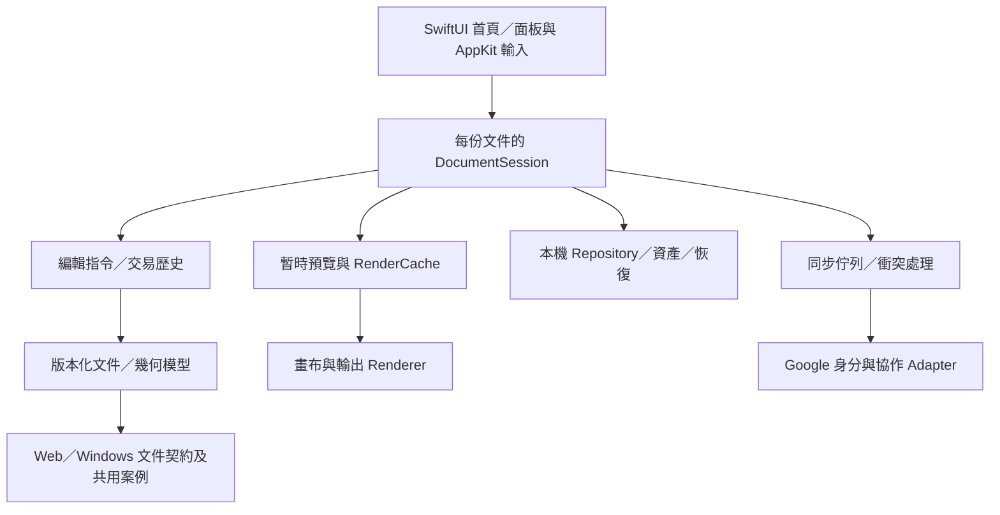

# HeiBan 開發目標與階段計畫

日期：2026-10-02。目標產品：HeiBan 黑板。優先交付 macOS 原生本機版，完成核心功能與實機驗收後接通線上能力，再延伸 Web／Windows。

## 使用文件的方式

- [參考專案分析](EXCALIDRAW_DESKTOP_ANALYSIS.zh-TW.md)：借鑑的依據與架構判斷。
- 本文件：產品範圍、優先順序與開發階段。
- [驗收目標](ACCEPTANCE_CRITERIA.zh-TW.md)：功能與性能的通過標準，ID 為 A01–A31。
- [工作清單](WORK_BACKLOG.zh-TW.md)：實作工作、依賴與交付物，ID 為 W01–W29。
- [既有功能清單](FEATURE_PARITY_CHECKLIST.md)：保存已實作／部分完成／缺漏及過去驗收證據。過去通過不代表後續版本自動通過。

## 需求來源與修正優先序

來源為你提供的歷史對話附件及本次 HeiBan 對話。舊助手寫的「全部完成」「支援」表格是待查證敘述，不能充當需求來源或實測結果。較後的明確修正優先：

- 圖釘目的地為**左上舒適書寫區**，平滑移動，可自訂名稱；畫布上要有能拖拉的實體 ICON。
- 建立黑板時選固定／無限；固定可升級無限，無限不能縮回固定；輸出時另選範圍。
- 直線保存真正 A/B 端點、原方向及四種延伸模式，不以矩形角落取代端點。
- 主工具列、筆刷控制與物件屬性面板都要可移動；左右直向，上下橫向，選單向畫布內展開。
- 圓形調色盤、精簡首頁、可用的 Google 帳號入口與完整設定。
- 持續處理卡頓與筆跡折痕，原生版達到並以量測證明超過網頁版的操作品質。

## 開發目標

| ID | 開發目標 | 必須涵蓋的需求 | 驗收 |
|---|---|---|---|
| G01 | 可量測的低延遲畫布 | 長筆跡不累積卡頓、曲線不在放開後突變、滑鼠／觸控板可靠 | A01、A02、A10、A11 |
| G02 | 可持續編輯的向量文件 | 每筆獨立物件、穩定選取框、多選、變形、樣式與完整歷史 | A03–A08、A24 |
| G03 | Goodnotes 式精確工具 | 一秒停筆轉形、A/B 線段／射線、螢幕空間尺規與兩種橡皮擦 | A08、A09、A13、A14 |
| G04 | 符合電腦操作習慣的介面 | 四邊停靠、可移動筆刷／屬性面板、圓形色盤、簡潔首頁、快捷鍵 | A05、A12、A21、A22、A25 |
| G05 | 真正可用的文字與便簽 | 原地輸入、中文 IME、局部文字格式、便簽邊界與可愛樣式 | A15、A16 |
| G06 | 自由導航與紙張輸出 | 真無限畫布、固定紙張、單向升級、實體圖釘左上導航 | A10、A11、A17 |
| G07 | 高品質影像與輸出 | 原始圖片保存、裁切恢復、多螢幕截圖、SVG／PDF／PNG、列印及文件交換 | A18–A20、A23 |
| G08 | 可靠的本機桌面工作流程 | 離線、縮圖、資料夾、雙擊開檔、另存、外部衝突、恢復、多文件隔離 | A03、A04、A21、A23、A26、A27 |
| G09 | 完整的帳號、雲端與協作 | Google 登入、跨裝置保存、斷線恢復、至多十人、可關閉游標／軌跡 | A22、A28–A30 |
| G10 | 可維護並可擴展的平台 | 明確模組界線、共享格式與版本遷移、品質閘門、簽章發行、Web／Windows | A23、A27、A31 |

「本機完整版本」可離線完成創作與文件作業；完整產品驗收仍包括 Google 與十人協作，這些不是被刪除的需求。

本輪已確認 PDF 範圍：自產 PDF 可恢復 HeiBan 編輯資料；外部 PDF 支援插入與註記。詳見 A23／W21。

## 現況摘要

進度更新（2026-10-02）：工作清單已記錄 W01–W03、W09–W16 有實作與核心檢查證據，涵蓋畫布基線／快取、文件契約、原子保存／恢復、指令歷史、圖層、多選變形、A/B 線段、停筆轉形、固定／無限畫布、導航、尺規及局部橡皮擦。Web 與原生首頁、畫筆預覽及面板也有先前操作紀錄。

性能方面已有合成資料與程式管線量測；這不等於真實顯示器端到端延遲或使用者手寫流暢度已通過。高幀率錄影、實際筆／觸控板長時間繪圖和完整大文件 GUI 壓力驗收仍待完成。待開發重點是原地中文文字／局部富文本、便簽與實體圖釘；真實縮圖／資料夾與多文件流程、完整可移動三面板、圖片／SVG／PDF 匯出及 PDF 恢復／註記、原生 Google 登入與雲端協作、簽章發行。Google 登入尚未接通。

## 系統架構目標

- `HeiBanCore` 逐步移除 AppKit 對話框、SwiftUI View／動畫與雲端耦合；幾何、文件、指令可獨立驗證。
- `DocumentSession` 每份文件各自持有選取、歷史、保存修訂及視角；多視窗不共用一個全域 engine。相同文件的多視窗須共享同一文件協調狀態，避免相互覆寫。
- 儲存以原子替換、修訂與恢復快照為基礎；圖片原檔與可重建縮圖分離。舊 JSON data URL 文件提供遷移與可攜備份。
- 輸入與預覽只更新必要區域；評估快取、可見區裁切、空間索引及增量歷史。是否改用 Metal 應由 profiler 證據決定。
- 同步介面先定義，再接 Google 與既有 Firebase adapter；網路錯誤不阻斷本機創作。

## 階段、優先級與退出條件

P0＝資料正確與性能阻塞；P1＝本機核心功能必做；P2＝完整產品的線上／發行工作必做；P3＝後續平台。數字表示開發順序，不表示 P2 可以永遠省略。

| 階段 | 工作 | 可交付成果 | 退出條件 |
|---|---|---|---|
| M0 基線與安全保存 | W01–W03、W09、W06 的 Session 邊界 | 基準文件、性能記錄、文件契約、保存／指令邊界 | A01–A04 有可重現結果；未達性能目標保留阻塞 |
| M1 原生編輯與操作 | W10–W19、W06–W08 | 可用的編輯、文字、尺、圖釘、畫布設定及控制面板 | A05–A17、A24、A25 逐項驗收 |
| M2 完整本機工作流程 | W04–W05、W20–W23 | 真縮圖、可恢復刪除、檔案整合、圖片、輸出／列印、設定 | A18–A23、A26、A27；A22 帳號子項接到 M3；M0/M1 不退步 |
| M3 帳號與多人協作 | W24–W27 | 可登入、跨裝置保存、斷線佇列、十人協作及可關閉游標 | A22 帳號子項、A28–A30；邀請及人數限制由服務端執行 |
| M4 發行與延伸平台 | W28–W29 | 經簽章公證的 macOS 產物、跨平台文件／行為案例 | A31；Windows/Web 可讀寫相同文件 |

W24 的帳號／同步契約可在 M0/M1 定義；實際接通前，UI 顯示真實狀態。原生版不能因為出現 Google 按鈕就宣告完成登入。

## 參考分析後的下一步（2026-10-03）

Excalidraw Desktop 借鑑其桌面檔案流程與克制的工作區介面；HeiBan 繼續以原生、離線可用、可編輯文件為基礎，保留尺規、可調整曲線錨點、圖層、實體圖釘、便簽及未來多人協作等產品方向。依目前未結案需求，開發順序如下：

1. **P0：筆跡即時品質**（W01/W12）。減少每個滑鼠樣本引發的繪製工作，保證分段接縫、筆跡首尾與放開時預覽／成品一致；以真實長筆跡、滑鼠及觸控板操作作為驗收證據。這次先將封存筆跡 chunk 合併成一個 Path，減少逐 chunk 的繪製呼叫；它是降低渲染開銷的一步，尚不等於完成端到端流暢驗收。
2. **P1：HeiBan 專屬創作物件**（W17–W19、W12 曲線子項）。完成可編輯文字、便簽的實體邊界與排版、可拖動並能導覽至舒適書寫區的圖釘，以及曲線控制點；每項都須能選取、修改、復原並保存重開。
3. **P1：桌面操作與視覺**（W04–W08）。以縮圖首頁、工作資料夾／檔案流程與獨立可停靠面板，吸收參考專案清楚的桌面操作方式；保留 HeiBan 的圓形調色盤、尺規、圖層和可自訂工具配置。完成左右直向、上下橫向、收合狀態和重啟恢復。
4. **P1：影像與交付**（W20–W23）。完成拖入／剪貼簿圖像的非破壞裁切與恢復、PNG/SVG/PDF 匯出、PDF 註記與文件恢復、列印及設定；首頁與設定需有真實 Google 帳號狀態入口。
5. **P2：帳號與協作**（W24–W27）。在本機文件流程和格式穩定後，接上真實 Google OAuth、離線同步佇列和最多十人的協作，不用展示按鈕冒充已登入或已同步。
6. **P2：發行品質**（W28–W29）。完成 macOS 簽章／公證與跨平台文件一致性，再規劃線上版及 Windows 版。

本輪實作切片是 **W01/W12：即時筆跡每次更新只發出一個封存 Path 的描繪呼叫**。後續仍要檢查真實輸入樣本、分段邊界、透明筆刷接縫及完整長筆跡性能；本次沒有做 GUI 實測，也不把合成基準當成流暢度驗收。

## 完成定義與工作流程

1. 每項工作先讀對應歷史需求與 Web／Swift 原始碼，確認資料欄位、互動與缺口。
2. 一次交付模型／指令 → 互動 → 呈現 → 保存 → 復原 → 驗收的完整流程。
3. 更新工作狀態並連到 A 編號；變更文件欄位時補版本與跨客戶端檔案案例。
4. 驗收記錄包含版本、設備、步驟、實際結果及證據；有按鈕、編譯通過或助手口頭宣稱都不足以完成。
5. 性能與資料保存是每階段的回歸閘門。不能用小空白板的流暢度代表大文件。
6. W17 原地文字編輯已開始並通過原生 Swift package 建置；本輪沒有執行 App 功能／性能測試或手動輸入法驗收，該工作維持部分完成。
