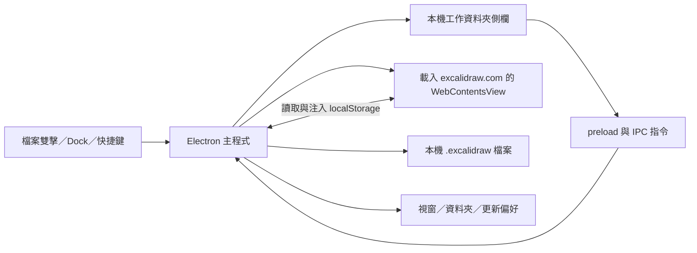

# Excalidraw Desktop 借鑑分析

分析日期：2026-10-02。方法：讀取原始碼、設定與工作流程；未安裝或執行參考 App，以下不代表其實機性能或可靠性驗收。

## 分析版本與來源

- 專案：[pgkt04/excalidraw-desktop](https://github.com/pgkt04/excalidraw-desktop)。
- 固定版本：`f4de0bba794b6170a6fc2d8e65777b464372946d`，`package.json` 版本為 1.0.9。
- 閱讀範圍：`README.md`、`index.js`、`sidebar/sidebar.js`、側欄與新增檔案對話框的 preload、`package.json`、`.github/workflows/build.yml`、`LICENSE`。CSS/HTML 用於了解側欄與對話框結構，未做視覺實測。
- 原始碼固定連結：[主程式](https://github.com/pgkt04/excalidraw-desktop/blob/f4de0bba794b6170a6fc2d8e65777b464372946d/index.js)、[側欄](https://github.com/pgkt04/excalidraw-desktop/blob/f4de0bba794b6170a6fc2d8e65777b464372946d/sidebar/sidebar.js)、[打包設定](https://github.com/pgkt04/excalidraw-desktop/blob/f4de0bba794b6170a6fc2d8e65777b464372946d/package.json)、[建置流程](https://github.com/pgkt04/excalidraw-desktop/blob/f4de0bba794b6170a6fc2d8e65777b464372946d/.github/workflows/build.yml)。

## 實際架構

繪圖介面由載入的 Excalidraw 網頁提供；這個 repository 的主要價值是桌面整合與檔案工作流程。主程式明確呼叫 `loadURL`，檔案開啟透過寫入網頁的 localStorage 後重新載入。它沒有在此提供可直接搬入 Swift 的繪圖引擎，也沒有實作 HeiBan 所需的尺規、Google 帳號服務或十人協作契約。[主程式](https://github.com/pgkt04/excalidraw-desktop/blob/f4de0bba794b6170a6fc2d8e65777b464372946d/index.js)

## 可採用的設計與 HeiBan 對應工作

| 參考設計 | 原始碼證據 | HeiBan 採用方式 | 工作 ID |
|---|---|---|---|
| 工作資料夾、可收合側欄、目前檔案標示 | `scanWorkspaceFiles`、`setWorkspace`、`sidebar.js` | 在縮圖首頁之外提供資料夾瀏覽；列表與畫布保持同一文件狀態 | W05 |
| 新增／開啟／儲存／另存與快捷鍵 | `createNewFileInWindow`、`saveCurrentWindow`、選單 template | 補齊 macOS 文件選單；手動存檔與背景保存語意清楚 | W06 |
| 重新命名重名檢查、刪除到垃圾桶 | `sanitizeBaseName`、`renameFileInWindow`、`shell.trashItem` | 保存原檔、避免覆蓋；首頁刪除可從垃圾桶恢復 | W04、W05 |
| 雙擊檔案與 Dock 開啟、啟動前收到檔案事件 | `open-file`、`pendingFilePath`、`fileAssociations` | 註冊 HeiBan 文件類型；冷啟動與已開啟 App 都能正確接收 | W06 |
| 修改狀態只比較作品內容 | `hashContent` 排除暫時的 appState | 文件修訂編號與已保存修訂比較；縮放、選取不會誤報作品修改 | W02、W03 |
| 切換／關閉時先處理未保存內容 | `openFileInWindow`、視窗 `close` handler | 先確認保存成功；失敗保留文件並提供恢復路徑 | W03 |
| 資料夾監看與去抖 | `watchWorkspace`、`debounceRefresh` | 列表增刪重新整理與內容衝突分開處理；避免自動保存覆蓋外部修改 | W05 |
| 視窗位置恢復且檢查目前螢幕 | `isValidWindowBounds`、`saveWindowState` | 拔除外接螢幕後仍能看到視窗與面板 | W07 |
| 更新提示有間隔、逾時、版本去重 | `checkForUpdates`、`fetchLatestRelease` | About／更新入口、失敗重試；正式版再接簽章更新機制 | W28 |
| 各平台建置與 draft release | workflow 分平台產物，Release 為 draft | 先建立 macOS 品質閘門與可追溯產物，再拓展其他平台 | W28、W29 |

## 需要改進後才能採用的部分

以下是靜態原始碼觀察及其對 HeiBan 的設計影響，尚未透過執行參考 App 重現。

| 觀察 | HeiBan 設計決定 |
|---|---|
| 離線能力依賴遠端網頁與快取，README 也說首次啟動需要網路 | 原生本機功能首次啟動即離線可用；不把畫布載入綁在遠端網站 |
| 文件讀寫與資料夾掃描使用多處同步 fs 操作 | 大文件解碼、資產與縮圖工作放背景；主執行緒處理互動與結果 |
| `writeCanvasToFile` 直接覆寫，沒有顯示原子替換或恢復檔流程 | 延續原子寫入，加入可驗證快照與恢復入口 |
| `hasUnsavedChanges` 讀取畫布失敗時回傳 false | 保存狀態無法確定時顯示失敗並保留內容，不把錯誤解釋成已保存 |
| 開檔透過覆寫 `localStorage.setItem` 與 reload 協調保存 | 文件切換採明確交易及修訂序列，避免靠頁面生命週期競態完成 |
| 有 per-window map，但未看到 content view 的 session partition | 多文件隔離須另做驗收；不能由「可開多視窗」推定資料不會互相影響 |
| 遠端 content view 設定 `nodeIntegration: true` | HeiBan 原生文件／檔案存取由受控介面處理；將來若有網頁內容，分離檔案能力 |
| `package.json` 的 test 為未設定的佔位指令；CI 建置不等於功能驗收 | 核心、文件、UI、效能與協作各有證據，通過後才進入發行 |
| README 說 macOS 未公證；LICENSE 與 package license 欄位不同 | HeiBan 發行前完成簽章與公證；若未來重用第三方程式或資產，逐項記錄來源與授權標記 |

## 對 HeiBan 架構的結論

1. 保持 SwiftUI + AppKit 原生 macOS 路線，以桌面檔案工作流程作為此次借鑑重點。
2. 文件資料、編輯指令、預覽、儲存、同步各自有介面。現有 `BoardEngine` 還混合 AppKit、SwiftUI、檔案對話框與編輯邏輯；拆層是開發工作，不能當成目前已完成的架構。
3. 以文件契約與驗收案例支援後續 Web／Windows；各平台使用適合自己的輸入與呈現方式。
4. 若要繼續研究筆跡、命中測試或選取效能，需要另外審讀 [Excalidraw 核心專案](https://github.com/excalidraw/excalidraw) 對應模組。本次分析沒有據此聲稱取得完整繪圖引擎實作。
5. HeiBan 的功能範圍由你的對話需求與開發計畫決定。參考專案的功能數量或 README 宣稱不能作為 HeiBan 完成驗收的證據。

下一份文件：[開發目標](DEVELOPMENT_PLAN.zh-TW.md)。
