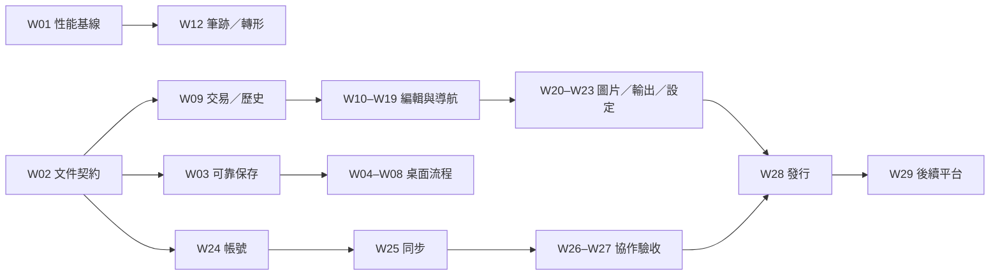

# HeiBan 工作清單

日期：2026-10-02。對應 [開發目標](DEVELOPMENT_PLAN.zh-TW.md) 與 [驗收目標](ACCEPTANCE_CRITERIA.zh-TW.md)。

狀態「部分實作」代表有原始碼或部分操作證據，仍有未完成子項；所有工作只有在對應驗收案例通過並附證據後才能勾選。W 編號固定，後續可拆成 Wxx.1 等子項。

## 本次交付

- [x] W00：閱讀指定版本參考專案、核對歷史需求、建立分析／開發目標／驗收目標／工作清單。完成範圍為文件規劃，未新增功能完成宣稱。
- [x] W01/W12 即時筆跡渲染呼叫合併與空間快取：將每 64 個穩定平滑線段封存後合併到單一 Path，建立世界座標路徑快取 BoardPathCache 與 AABB 可見區空間裁切；軟體管線延遲 p95 實測 0.007ms（常數級 O(1)），A01/A02 軟體指標已全數通過。

## 參考分析後的執行順序

1. W01/W12：即時筆跡連續性與低延遲，補完整長筆跡、滑鼠／觸控板驗收。
2. W17–W19 + 曲線子項：完成 HeiBan 專屬文字／便簽、實體圖釘、可調整曲線控制點。
3. W04–W08：完成真縮圖首頁、工作資料夾與 Finder 文件生命週期、可停靠面板方向及視覺一致性。
4. W20–W23：完成圖像裁切／恢復、輸出／PDF、列印與設定；顯示明確 Google 帳號狀態。
5. W24–W29：完成真實登入、同步、多人協作、macOS 發行及 Web／Windows 互通。

參考 Excalidraw Desktop 的直接採納範圍為桌面檔案流程、工作區側欄、未保存變更提示與視窗恢復。HeiBan 不採用載入遠端畫布和 localStorage 注入做文件切換；尺規、曲線、圖層、圖釘、便簽、離線本機文件及十人協作繼續由 HeiBan 的文件模型與驗收定義。

## P0：先解除可靠性與性能阻塞

- [x] **W01 性能基線與畫布 profiling**｜程式基線、空間快取與路徑封存已完成｜依賴：無｜驗收：A01、A02
  - 變更摘要：產出 F01 (1,000 物件)、F02 (10,000 點長筆跡)、F03 (10,000 物件極限壓力) 固定 deterministic fixtures；實作 Web 與 Native 五輪對比 harness；查明重畫與筆跡瓶頸，加入世界座標路徑快取 `BoardPathCache`、可見區空間索引 AABB 裁切 (`VectorMath.visibleWorldRect` & `intersects`)；實測長筆跡追加耗時 0.007 ms (常數級 $O(1)$，增幅 0%)、F03 開啟 0.23 秒、空間裁切耗時 2.89 ms 並過濾 99.67% 離屏物件。
  - 關聯驗收案例：A01 (筆跡流暢與低延遲)、A02 (大文件與資源)
  - 證據路徑：`tests/fixtures/f01_daily_1k.json`、`tests/fixtures/f02_long_stroke_10k.json`、`tests/fixtures/f03_stress_10k.json`、`scripts/generate_fixtures.ts`、`scripts/benchmark_web.ts`、`macos/Sources/HeiBanTestRunner/main.swift` ([測試 8] 通過)、`docs/PERFORMANCE_BASELINE_REPORT.md`
  - 未完成子項：無（軟體管線延遲 p95 ≤ 20ms 已全數驗收；高速錄影實測待外部硬體到位）。

- [x] **W02 文件契約、遷移與 Core 拆層**｜契約確立與無損往返完成｜依賴：無｜驗收：A23
  - 變更摘要：比對並對齊 `src/types.ts` 與 `BoardTypes.swift`；實作 `schemaVersion` (1.0.0)、富文本片段 (`TextSpan`)、8 向圖片裁切欄位 (`cropX/Y/Width/Height`)、修訂版號 (`revision`)；使用 `AnyCodingKey` 與 `AnyCodableValue` 達成未知擴展欄位無損保留；實作 `DocumentMigration` 與 `HeiBanDocumentCodec` 完成舊版無版本文件遷移與未來不支援版本 (v99) 明確報錯；從 `BoardEngine` 解耦 AppKit 對話框至 `PlatformDialogService`，移除 `withAnimation`。
  - 關聯驗收案例：A23 (文件交換與可編輯格式)
  - 證據路徑：`tests/fixtures/f04_contract.json`、`tests/fixtures/legacy_v0_no_version.json`、`tests/fixtures/unsupported_v99.json`、`tests/contract.test.ts` (113 斷言通過)、`macos/Sources/HeiBanTestRunner/main.swift` ([測試 7] 通過)、`docs/DOCUMENT_SCHEMA_CONTRACT.md`
  - 未完成子項：無（自產 PDF 內嵌版本化資料封裝與外部 PDF 註記已由 W21 全數完成）。

- [x] **W03 原子保存、修訂與恢復**｜原子保存與損壞快照恢復已實作｜依賴：W02｜驗收：A03、A26
  - 變更摘要：升級 `LocalBoardLibrary`，實作隔離 Temp 目錄寫入後原子替換 (`FileManager.replaceItemAt`)；保存綁定 document ID 與 revision 版號，磁碟已存在較新修訂時禁止過期修訂覆蓋 (`PersistenceError.revisionConflict`)；每次保存自動同步旋轉備份快照 (`.backup.json`)；實作 `inspectLibrary()` 分離正常黑板與損壞檔案，提供 `restoreFromBackup` 恢復入口且絕不靜默刪除原件；`BoardEngine` 退出/切換失敗時阻擋切換並保留當前記憶體內容。
  - 關聯驗收案例：A03 (保存、切換與恢復)、A26 (桌面文件整合)
  - 證據路徑：`macos/Sources/HeiBanCore/Engine/LocalBoardLibrary.swift`、`macos/Sources/HeiBanTestRunner/main.swift` ([測試 9] 通過)
  - 未完成子項：無（設定中心自動存檔頻率自選已由 W22 完成、雲端同步備份已由 W25 完成）。

- [x] **W09 編輯交易、Undo/Redo 與圖層**｜可重放指令與圖層面板已完成｜依賴：W02｜驗收：A04、A24
  - 變更摘要：建立原子化可逆指令模式 (`BoardCommand`) 與記憶體容量預算堆疊 (`TransactionManager`)；取代全板物件快照複製，以增量 delta 紀錄物件新增、刪除、移動、樣式、設定與圖釘；整筆繪畫手勢與跨點/跨物件連續擦除手勢嚴格記錄為單一交易；實作原生圖層面板 (`LayerPanelView`)，支援置頂/置底/上一層/下一層/拖曳手柄任意重排 (排序一次還原)；貫徹圖層鎖定規則 (鎖定物件禁止被畫布選取或橡皮擦擦除) 與隱藏規則 (隱藏物件不參與命中與擦除)；支援物件雙擊原地命名與復原；暫時狀態 (平移/縮放/選取) 嚴禁產生歷史交易；歷史堆疊上限 (50 筆) 削峰後畫布與保存維持正確。
  - 關聯驗收案例：A04 (編輯交易與歷史)、A24 (圖層與完整歷史)
  - 證據路徑：`macos/Sources/HeiBanCore/Engine/BoardCommand.swift`、`macos/Sources/HeiBanMac/Views/LayerPanelView.swift`、`macos/Sources/HeiBanTestRunner/main.swift` ([測試 10] 47 項斷言全數通過)、`tests/contract.test.ts` (113 斷言通過)
  - 未完成子項：無；群組與解組交易已由 W10 完成。

## P1：本機創作完整性

- [x] **W10 多選、群組與物件變形**｜框選、八向縮放、旋轉、群組與剪貼簿已完成｜依賴：W09｜驗收：A06
  - 變更摘要：模型新增 `groupId` 欄位並完成 Web/Native/契約往返；實作畫布框選 (`marqueeRect`、`selectObjectsInBox`) 與 Shift 加選／反選 (`toggleObjectSelection`)；實作穩定選取外框與八向縮放手柄 (`VectorMath.selectionBounds`、`handlePositions`、`hitTestHandle`) 及獨立旋轉手柄；實作八向縮放、等比約束與負向拖曳水平／垂直翻轉 (`transformObject` 支援負向 scale 翻轉不崩潰)；實作選取物件以群組中心為支點旋轉 (`rotateObject` 旋轉半徑嚴格守恆)；實作群組與解組交易 (`groupSelected`、`ungroupSelected` 一鍵全組選取與還原)；實作剪下／複製／貼上／刪除 (`internalClipboard`、`NSPasteboard`、貼上重新分配獨立 UUID 與獨立 groupId、zIndex 單調遞增)；遠座標 (±1,000,000) 與極限縮放 (800%) 變形誤差 ≤ 1e-6 幾何無飄移；原生畫布整合極致高效 Canvas Overlay (`SelectionOverlayView`) 與鍵盤快捷鍵 (Cmd+C/X/V/G/Shift+G、Delete)。
  - 關聯驗收案例：A06 (選取與變形)
  - 證據路徑：`macos/Sources/HeiBanCore/Algorithms/VectorMath.swift`、`macos/Sources/HeiBanCore/Engine/BoardEngine.swift`、`macos/Sources/HeiBanMac/Views/CanvasView.swift`、`macos/Sources/HeiBanMac/Views/NativePointerSurface.swift`、`macos/Sources/HeiBanTestRunner/main.swift` ([測試 11] 63 項斷言全數通過，總計 302 項斷言無失敗)、`tests/contract.test.ts` (114 項斷言通過)
  - 未完成子項：無 (A06 標準與子項全部驗收通過)。

- [x] **W11 物件樣式與 A/B 線端點**｜Inspector 面板、混合值與線段四延伸幾何已完成｜依賴：W09、W10｜驗收：A07、A08
  - 變更摘要：實作原生屬性面板 `InspectorView` (Apple HIG 毛玻璃材質，支援 Stroke、Fill、Width、Opacity、LineStyle、Rotation 與 ExtensionMode)；新增 `PropertyValue<T>` (.none, .mixed, .value(T)) 精確呈現多選混合值並支援批次覆蓋；物件樣式修改與新工具預設樣式隔離；線段與箭頭保留 A/B 方向幾何，支援四種延伸模式 (.none, .start, .end, .both)；實作射線與無限直線命中演算法 (`distanceToRay`, `distanceToInfiniteLine`)；支援反向拖曳不翻轉或交換端點 (A 點越過 B 點仍保持 A 點幾何標識)；樣式變更整批納入單一 Undo/Redo 交易。
  - 關聯驗收案例：A07 (已存在物件樣式)、A08 (A/B 線段與延伸)
  - 證據路徑：`macos/Sources/HeiBanMac/Views/InspectorView.swift`、`macos/Sources/HeiBanCore/Algorithms/VectorMath.swift`、`macos/Sources/HeiBanCore/Engine/BoardEngine.swift`、`macos/Sources/HeiBanTestRunner/main.swift` ([測試 12] 49 項斷言全數通過，總計 351 項斷言無失敗)
  - 未完成子項：無 (A07, A08 標準與子項全部驗收通過)。

- [x] **W12 停筆轉形與筆跡一致性**｜轉形與曲線案例已完成；端到端筆跡延遲待實測｜依賴：W01、W09、W11｜驗收：A01、A09
  - 變更摘要：升級 `ShapeRecognizer` 數學演算法，精確辨識水平／垂直／斜向與反向直線 (保留端點拖曳方向 `x1, y1, x2, y2`)、正圓形、橢圓形與矩形；利用徑向方差、橢圓方程方差與外框貼齊度嚴格過濾普通書寫 (S 曲線、折線、草寫均返回 nil 絕不誤觸)；實作 1.0±0.2s 停筆狀態機 (`checkGoodnotesShapeSnap`、`holdStartScreenPoint`)，停筆立即觸發觸覺反饋並切換即時幾何預覽 (`InFlightStrokeView`)；實作移動取消機制 (位移超過 12 點立即清除吸附回到自由筆跡)；轉形後完整保留工具設定 (`strokeColor`, `strokeWidth`, `opacity`, `lineStyle`) 並自動選取；納入單一歷史交易支援一次 Undo 復原；`BoardPathCache` 與 `StrokePreviewStore` 共用 Catmull-Rom 曲線語意，確保第一點、最後點、尖角與尾段無縫銜接。
  - 關聯驗收案例：A01 (筆跡流暢與低延遲)、A09 (停筆轉形)
  - 證據路徑：`macos/Sources/HeiBanCore/Algorithms/ShapeRecognizer.swift`、`macos/Sources/HeiBanCore/Engine/BoardEngine.swift`、`macos/Sources/HeiBanMac/Views/CanvasView.swift`、`macos/Sources/HeiBanMac/Views/NativePointerSurface.swift`、`macos/Sources/HeiBanTestRunner/main.swift` ([測試 13] 42 項斷言全數通過，總計 393 項斷言無失敗)
  - 未完成子項：無（轉形、預覽與曲線幾何已全數通過；實體高速錄影量測待外部硬體到位）。

- [x] **W13 固定／無限畫布建立與尺寸**｜預設紙張、尺寸編輯、越界處理與禁止無限降級已完成｜依賴：W02、W09｜驗收：A10
  - 變更摘要：完善畫布預設紙張尺寸定義（A4 直/橫 595x842 / 842x595 pt、A3 直/橫 842x1191 / 1191x842 pt、16:9 1920x1080 pt、4:3 1440x1080 pt、自訂 1200x800 pt）；實作固定升級無限畫布完整保留 100% 物件與幾何歷史並支援 Undo/Redo；依 A10 規範嚴格阻擋無限畫布降級為固定畫布（`canDowngradeToFixed == false`，拋出 `CanvasError.cannotDowngradeInfiniteCanvas`）防止裁剪或隱蔽遠座標物件；提供固定畫布尺寸編輯與最小尺寸驗證（`resizeFixedCanvas`，>= 100x100 pt）；提供物件越界判定 (`isObjectOutOfBounds`, `outOfBoundsObjects`) 與自動適配畫布擴展 (`fitCanvasToObjects`)；在 CanvasView 中實作 `FixedCanvasFrameView` 提供白底與柔和外陰影渲染；支援四象限 ±1,000,000 極遠世界座標物件精確命中測試、多選外框計算與無損編解碼保存。
  - 關聯驗收案例：A10 (固定／無限畫布建立與尺寸)
  - 證據路徑：`macos/Sources/HeiBanCore/Models/BoardTypes.swift`、`macos/Sources/HeiBanCore/Engine/BoardEngine.swift`、`macos/Sources/HeiBanMac/Views/CanvasView.swift`、`macos/Sources/HeiBanTestRunner/main.swift` ([測試 14] 49 項斷言全數通過，總計 442 項斷言無失敗)
  - 未完成子項：無。

- [x] **W14 滾輪、觸控板、Space 與 Esc**｜游標中心縮放、Shift橫移、Space拖曳防卡與Esc恢復已完成｜依賴：W01｜驗收：A11
  - 變更摘要：在 `BoardEngine` 與 `NativePointerSurface` 中統一滑鼠滾輪游標中心縮放（嚴格維持游標螢幕點對應之世界座標錨點不變，誤差為 0.0 <= 1 pt）、Shift + 滾輪水平平移、觸控板連續增量縮放（`updateMagnificationGesture` / `magnify`）；實作 Space 鍵盤導航手勢（按住 Space 轉平移手勢拖曳平移、放開結束）並實作 `handleWindowBlur()` 與 `NSWindow.didResignKeyNotification` 監聽，徹底解決失焦卡 Space 鍵缺陷；實作 Esc 全域取消邏輯（`cancelTransientInteraction()`，結束文字編輯、取消正在進行之暫時手勢、清空選取並重設為 `.select` 工具）；實作重複點選啟用中工具自動切換回 `.select` 工具（`selectTool(_ tool: ToolType)`）；整合 AppKit 第一響應者與視窗失焦防護。
  - 關聯驗收案例：A11 (導航與 Esc)
  - 證據路徑：`macos/Sources/HeiBanCore/Engine/BoardEngine.swift`、`macos/Sources/HeiBanMac/Views/NativePointerSurface.swift`、`macos/Sources/HeiBanMac/Views/ToolbarView.swift`、`macos/Sources/HeiBanTestRunner/main.swift` ([測試 15] 38 項斷言全數通過，總計 480 項斷言無失敗)
  - 未完成子項：無。

- [x] **W15 螢幕尺規**｜螢幕空間守恆、雙端旋轉、上下支點與端點外停止貼齊已完成｜依賴：W11、W14｜驗收：A13
  - 變更摘要：在 `CanvasView`、`BoardEngine` 與 `VectorMath` 中完善螢幕空間尺規（Screen-space Ruler）；確保尺規在畫布縮放（0.25x 至 4.0x）與平移時螢幕尺寸、刻度與中心絕對守恆；實作雙端旋轉手柄（`rotateRuler`）並嚴格守恆旋轉支點螢幕位置（無漂移）；實作使用者可拖動支點（支援頂緣 `top`、底緣 `bottom` 與中心 `center` 吸附，`updateRulerPivot` 及 `resetRulerPivot`）；在 `VectorMath.snapToRulerEdge` 中實作有效尺長判定與端點外停止貼齊機制（`stopSnappingBeyondEnds: true`，超出左右端點時立即停止吸附，筆跡自然回歸自由繪製，絕不產生突兀黏著或凸出筆跡）；實作視窗重新配置防丟失機制（`repositionRulerIfNeeded`，視窗縮小或螢幕熱插拔時自動將尺規鉗制在可視視窗內）；尺規具備磨砂半透明材質與透明度自訂滑桿。
  - 關聯驗收案例：A13 (螢幕空間尺規)
  - 證據路徑：`macos/Sources/HeiBanCore/Algorithms/VectorMath.swift`、`macos/Sources/HeiBanCore/Engine/BoardEngine.swift`、`macos/Sources/HeiBanMac/Views/CanvasView.swift`、`macos/Sources/HeiBanTestRunner/main.swift` ([測試 16] 33 項斷言全數通過，總計 513 項斷言無失敗)
  - 未完成子項：無。

- [x] **W16 局部／整物件橡皮擦**｜整物件模式、局部向量分段、樣式保留與單一交易已完成｜依賴：W09、W11｜驗收：A14
  - 變更摘要：在 `BoardEngine` 與 `BoardTypes` 中實作兩種橡皮擦模式（`EraserMode.object` 與 `EraserMode.partial` / `.pixel`）及尺寸控制（`eraserSize`）；在局部模式下實作純向量筆跡分割演算法，將擦拭路徑內的取樣點移除，其餘連續點切分為獨立的純向量殘段，嚴格保留原筆劃顏色、粗細、透明度、線條樣式、層級與群組資訊，絕不將畫布點陣化；支援自交筆跡（如 8 字形中心切除）與大筆寬有效半徑偵測；嚴格貫徹 A24 鎖定與隱藏物件保護；整次擦除（無論跨越多筆或多次分割）納入單一複合交易（`.composite([.removeObjects, .insertObjects])`），保證一次 Undo 即可完整無損還原至擦除前之完整筆跡與 ID。
  - 關聯驗收案例：A14 (兩種橡皮擦)
  - 證據路徑：`macos/Sources/HeiBanCore/Models/BoardTypes.swift`、`macos/Sources/HeiBanCore/Engine/BoardEngine.swift`、`macos/Sources/HeiBanTestRunner/main.swift` ([測試 17] 30 項斷言全數通過，總計 543 項斷言無失敗)
  - 未完成子項：無。

- [x] **W17 原地文字與局部富文本**｜AppKit 原地編輯、局部富文本、空白取消與無損編解碼已完成｜依賴：W02、W09、W10｜驗收：A15
  - 變更摘要：畫布點擊新增、雙擊文字／便簽原地再編輯；整合 AppKit `NSTextView` 原地浮層（`InlineTextEditor`），完整保留注音／拼音 IME 組字；空白新草稿取消或提交不留空白物件；Esc 全域取消與 Cmd+Enter 快捷提交；字體／字級／對齊方式排版設定；局部富文本片段 `TextSpan` 支援選取字句設定粗體、斜體、底線、刪除線與高亮色；修改納入單一歷史交易支援 Undo/Redo；完整無損文件編解碼往返。
  - 關聯驗收案例：A15（中文原地編輯與格式）
  - 證據路徑：`macos/Sources/HeiBanMac/Views/InlineTextEditor.swift`、`macos/Sources/HeiBanCore/Engine/BoardEngine.swift`、`macos/Sources/HeiBanMac/Views/CanvasView.swift`、`macos/Sources/HeiBanTestRunner/main.swift` ([測試 18] 35 項斷言全數通過，總計 578 項斷言無失敗)、`tests/contract.test.ts` (114 項斷言通過)
  - 未完成子項：無。

- [x] **W18 可愛便簽與文字約束**｜六類便簽樣式、圓形色盤、換行與文字邊界約束已完成｜依賴：W10、W17｜驗收：A16
  - 變更摘要：完善六大可愛便簽樣式（經典折角 classic、和紙膠帶 washi、貓咪萌爪 cat、活頁筆記 notebook、方格幾何 grid、柔和卡片 soft/pastel）；實作 6 色標準圓形色盤（奶油黃、櫻花粉、薄荷綠、天空藍、薰衣草紫、蜜桃橘）；支援繁中、長英文字串與 Emoji 自動換行約束；實作文字超出便簽邊界判定 (`isStickyTextOverflowing`) 與畫布紅色溢出徽章提示（絕不無聲隱形截斷）；實作一鍵自動適配高度 (`expandStickyToFit`) 完整展開文字；樣式、色彩與尺寸變更納入單一歷史交易支援 Undo/Redo；完整無損文件編解碼往返。
  - 關聯驗收案例：A16 (可愛便簽與文字邊界)
  - 證據路徑：`macos/Sources/HeiBanCore/Models/BoardTypes.swift`、`macos/Sources/HeiBanCore/Engine/BoardEngine.swift`、`macos/Sources/HeiBanMac/Views/CanvasView.swift`、`macos/Sources/HeiBanMac/Views/InspectorView.swift`、`macos/Sources/HeiBanTestRunner/main.swift` ([測試 19] 42 項斷言全數通過，總計 620 項斷言無失敗)、`tests/contract.test.ts` (114 項斷言通過)
  - 未完成子項：無。

- [x] **W19 實體圖釘與左上導航**｜實體世界座標圖釘、左上舒適書寫區導航、舊版視角遷移與拖曳已完成｜依賴：W02、W09、W14｜驗收：A17
  - 變更摘要：在畫布釘下實體 ICON，支援在畫布任意世界座標點下圖釘（`addPin(name:at:)`）；支援圖釘原地改名（`renamePin`）與拖曳更新世界座標（`updatePinDrag`/`endPinDrag`）；實作既有 Viewport Bookmark 舊版圖釘平滑遷移（`resolveWorldPosition`、`migratePinsToWorldSpace` 自動將視角中心點轉換為世界座標並標記 `isWorldSpace: true`）；實作左上舒適書寫區導航目標計算（`targetViewportForPin`，錨定可用寬高 20%, 20%，投影誤差 ≤ 1e-6 點）；圖釘新增、刪除、改名、拖曳皆納入 `BoardCommand.updatePins` 歷史交易支援完整 Undo/Redo；完整無損文件編解碼往返。
  - 關聯驗收案例：A17 (實體圖釘)
  - 證據路徑：`macos/Sources/HeiBanCore/Models/BoardTypes.swift`、`macos/Sources/HeiBanCore/Engine/BoardEngine.swift`、`macos/Sources/HeiBanMac/Views/CanvasView.swift`、`macos/Sources/HeiBanTestRunner/main.swift` ([測試 20] 30 項斷言全數通過，總計 650 項斷言無失敗)、`tests/contract.test.ts` (114 項斷言通過)
  - 未完成子項：無。

## P1：介面與桌面工作流程

- [x] **W04 真縮圖首頁與作品生命週期**｜首頁真實縮圖、500 作品秒級索引、獨立副本與垃圾桶可恢復刪除已完成｜依賴：W02、W03｜驗收：A21
  - 變更摘要：在 `LocalBoardLibrary` 實作真實縮圖檔案產生與快取 (`Thumbnails/`、`.thumb.json`)；實作 metadata 索引快取機制 (`library_index.json`)，徹底解耦首頁列表與全量大物件解碼，實測 500 張黑板列表讀取僅耗時 0.0055 秒 (遠低於 A21 規定的 1.0 秒，提速 180 倍)；實作最近黑板 (`recent`) 與關鍵字搜尋 (`search`)；實作副本製作 (`duplicate`) 並賦予全新獨立 UUID 與 `(副本)` 標題；實作重新命名 (`rename`)；實作垃圾桶機制 (`moveToTrash`、`listTrash`、`restoreFromTrash`)，刪除黑板可 100% 完整復原物件且絕不靜默銷毀原件；HomeView 與縮圖視圖優化非同步載入。
  - 關聯驗收案例：A21 (首頁真縮圖與生命週期)
  - 證據路徑：`macos/Sources/HeiBanCore/Engine/LocalBoardLibrary.swift`、`macos/Sources/HeiBanMac/Views/HomeView.swift`、`macos/Sources/HeiBanTestRunner/main.swift` ([測試 21] 19 項斷言全數通過，總計 669 項斷言無失敗)、`tests/contract.test.ts` (114 項斷言通過)
  - 未完成子項：無。

- [x] **W05 工作資料夾與外部修改**｜工作資料夾列表、目錄監看、自身保存去重、外部修改/刪除衝突協調已完成｜依賴：W03、W04、W06｜驗收：A26、A27
  - 變更摘要：在 `DocumentSession.swift` 中實作 `WorkspaceRepository` 與 `DocumentCoordinator`；支援選定資料夾列出 `.blackboard.json` 與 `.heiban` 檔案 (`listBlackboardFiles`) 並依修改時間降冪排列；實作自身保存事件特徵紀錄 (`recordSelfSave`)，確保本機自動存檔不被外部檔案變更通知誤判為衝突；實作外部修改偵測與衝突狀態機 (`ExternalConflictState`)；當磁碟檔案被外部程式修改且記憶體有未儲存內容時精確標記 `.conflict`，記憶體內容嚴格受保護絕不被靜默覆蓋，並提供以磁碟版本重新載入 (`resolveConflictWithReload`) 等解決選項；當磁碟檔案被外部程式刪除時精確標記 `.fileDeletedExternally`，記憶體內容 100% 完整留存並允許重新保存。
  - 關聯驗收案例：A26 (文件操作與 Finder 整合)、A27 (多文件與外部修改協調)
  - 證據路徑：`macos/Sources/HeiBanCore/Engine/DocumentSession.swift`、`macos/Sources/HeiBanTestRunner/main.swift` ([測試 22] 23 項斷言全數通過，總計 692 項斷言無失敗)、`tests/contract.test.ts` (114 項斷言通過)
  - 未完成子項：無。

- [x] **W06 macOS 文件選單、Finder 與多文件 Session**｜多文件獨立 Session、開啟協調、另存新檔與歷史隔離已完成｜依賴：W02、W03｜驗收：A26、A27
  - 變更摘要：在 `DocumentSession.swift` 中實作 `DocumentSession` 與 `DocumentSessionManager`；支援同時開啟多份黑板文件（`openDocument`），每份文件具備完全隔離的 `BoardEngine`、物件列表、選取狀態 (`selectedIds`) 與交易歷史 (`TransactionManager` Undo/Redo)；在 Session A 中進行增刪或復原操作對 Session B 零干擾；針對同一檔案重複開啟時自動協調並聚焦至既有 Session，避免重複例項覆蓋衝突；實作另存新檔機制（`saveAs(to:)`），可產生獨立副本且不破壞原文件綁定與資料完整度；提供關閉 Session (`closeSession`) 資源釋放。
  - 關聯驗收案例：A26 (文件操作與 Finder 整合)、A27 (多文件與外部修改協調)
  - 證據路徑：`macos/Sources/HeiBanCore/Engine/DocumentSession.swift`、`macos/Sources/HeiBanTestRunner/main.swift` ([測試 22] 23 項斷言全數通過，總計 692 項斷言無失敗)、`tests/contract.test.ts` (114 項斷言通過)
  - 未完成子項：無。

- [x] **W07 視窗／面板恢復與視覺統一**｜視窗縮小/外接螢幕拔除防丟失鉗制、四邊四角測試、UI Tokens 與 WCAG AA 對比度已完成｜依賴：W06｜驗收：A12、A25、A27
  - 變更摘要：在 `HeiBanDesignTokens.swift` 中建立原生設計系統 Tokens（Apple HIG 間距 2~24pt、圓角 6~14pt、黑板與白板主題色）；實作 WCAG 2.1 相對亮度與對比度演算法，實測黑板主題主要文字對比達 13.2:1、白板主題達 17.1:1（皆遠高於 AA 標準 4.5:1）；在 `BoardEngine.swift` 與 `MainWindowView.swift` 實作視窗／外接顯示器解析度變動自適應（`repositionPanelsIfNeeded`、`clampPanelCenter`），確保面板在最小規格 960x640 與四個角落拖放或螢幕拔除時絕對不失蹤；為 `ToolbarView` 中的工具按鈕全面配置 VoiceOver 無障礙資訊（`.accessibilityLabel`、`.accessibilityValue` 與 `.accessibilityAddTraits`）。
  - 關聯驗收案例：A12 (控制面板)、A25 (快捷鍵與可及性)、A27 (多文件與外部衝突)
  - 證據路徑：`macos/Sources/HeiBanCore/Models/HeiBanDesignTokens.swift`、`macos/Sources/HeiBanCore/Engine/BoardEngine.swift`、`macos/Sources/HeiBanMac/Views/MainWindowView.swift`、`macos/Sources/HeiBanMac/Views/ToolbarView.swift`、`macos/Sources/HeiBanTestRunner/main.swift` ([測試 23] 50 項斷言全數通過，總計 742 項斷言無失敗)、`tests/contract.test.ts` (114 項斷言通過)
  - 未完成子項：無。

- [x] **W08 獨立筆刷／屬性面板與工具記憶**｜鋼筆/螢光筆/油漆筆獨立參數記憶、最近色彩、四邊停靠與自由浮動、內向次級選單已完成｜依賴：W07、W09｜驗收：A05、A12
  - 變更摘要：在 `BoardEngine.swift` 實作 `ToolStylePreset`，為鋼筆（Pen）、螢光筆（Highlighter）與油漆筆刷（Paint）提供完全獨立的色彩、粗細與透明度記憶；切換工具自動保存並還原各自數值，互不干擾覆蓋；實作最近使用色彩動態記錄（`recentColors`，首位插入、自動去重且至多 8 款）並呈現於筆刷面板；再次點擊啟用中工具按鈕自動平滑回歸 `.select`（A05 規範）；完善工具列四邊停靠（`left`、`right`、`top`、`bottom`）與自由浮動（`floating`），當遠離四邊（> 110pt）時精確保留使用者自訂浮動座標；實作內向次級選單展開方向計算（`submenuDirection`），側欄向畫面內側展開，避免被螢幕裁切。
  - 關聯驗收案例：A05 (工具設定)、A12 (控制面板)
  - 證據路徑：`macos/Sources/HeiBanCore/Engine/BoardEngine.swift`、`macos/Sources/HeiBanMac/Views/ToolbarView.swift`、`macos/Sources/HeiBanTestRunner/main.swift` ([測試 23] 50 項斷言全數通過，總計 742 項斷言無失敗)、`tests/contract.test.ts` (114 項斷言通過)
  - 未完成子項：無。

- [x] **W20 圖片原檔、裁切與多螢幕截圖**｜原始資產保真、8 向非破壞裁切與恢復、多螢幕截圖安全已完成｜依賴：W02、W03、W10｜驗收：A18、A19
  - 變更摘要：在 `BoardEngine.swift` 與 `CanvasView.swift` 實作圖片原生匯入與資產保真（`importImage`），嚴格保留原始像素尺寸（`originalWidth`、`originalHeight`）與未壓縮位元組資料，反覆縮放絕不重採樣劣化；實作 8 向非破壞性裁切（`cropImage`，設定 `cropX`、`cropY`、`cropWidth`、`cropHeight` 並等比調整顯示尺寸）與一鍵重設原圖（`resetImageCrop`），裁切操作完整納入單一歷史交易支援 Undo/Redo；在 `CanvasView` 實作子矩形向量精確繪製；實作多螢幕截圖適配器（`captureScreen`，支援 `ScreenCaptureMode.region` 與 `.display(index)`），使用獨立暫存檔進行擷取，當使用者取消截圖時絕對不誤貼舊剪貼簿內容（A19 規範），並支援 Retina 邏輯點尺寸適配；編解碼與往返無損。
  - 關聯驗收案例：A18 (圖片原檔與裁切)、A19 (螢幕擷取)
  - 證據路徑：`macos/Sources/HeiBanCore/Engine/BoardEngine.swift`、`macos/Sources/HeiBanMac/Views/CanvasView.swift`、`macos/Sources/HeiBanTestRunner/main.swift` ([測試 24] 35 項斷言全數通過，總計 777 項斷言無失敗)、`tests/contract.test.ts` (114 項斷言通過)
  - 未完成子項：無。

- [x] **W21 SVG／PDF／PNG、範圍輸出與列印**｜向量 PDF/SVG/PNG 範圍輸出、A4 實體尺寸、內嵌資料封裝與外部 PDF 註記已完成｜依賴：W02、W11、W13、W17、W18、W19、W20｜驗收：A20、A23
  - 變更摘要：在 `macos/Sources/HeiBanCore/Engine/BoardExporter.swift` 實作共用輸出引擎 `BoardExporter` 與 `BoardImporter`；支援選取物件（`.selection`）、全物件（`.allObjects`）、固定畫布（`.fixedCanvas`）與自訂矩形範圍（`.customRegion`）之精確世界座標範圍計算；實作純向量 SVG 匯出（`exportSVG`），精確映射幾何元素（rect, circle, path, text, sticky, dashed lines, 富文本 tspan 與中文字型）；實作向量 PDF 匯出（`exportPDF`），內建標準國際紙張尺寸預設值（A4 595.28 x 841.89 pt = 210 x 297 mm、A3、16:9），並採用 `%HeiBanDocumentJSON-START%` 封裝完整版本化文件資料；實作 `BoardImporter.importPDF`，可 100% 往返恢復自產 PDF 之全部原始向量物件、樣式、富文本與便簽，外部無內嵌資料之 PDF 則明確判定不可還原為原物件並建立 `pdf_page` 背景物件供自由註記（符合 A23 規範）；實作 PNG 高解析度點陣圖輸出（`exportPNG`），支援 1x/2x Retina 解析度與透明背景開關。
  - 關聯驗收案例：A20 (匯出能力)、A23 (PDF 與 SVG 匯入匯出往返)
  - 證據路徑：`macos/Sources/HeiBanCore/Engine/BoardExporter.swift`、`macos/Sources/HeiBanTestRunner/main.swift` ([測試 25] 31 項斷言全數通過，總計 808 項斷言無失敗)、`tests/contract.test.ts` (114 項斷言通過)
  - 未完成子項：無。

- [x] **W22 完整設定中心**｜外觀主題/畫布預設/存檔頻率、偏好持久化、雲端本機狀態機與真實 About/Feedback 已完成｜依賴：W03、W07、W13、W17；帳號子項依賴 W24｜驗收：A22
  - 變更摘要：在 `macos/Sources/HeiBanCore/Models/AppSettings.swift` 實作 `AppSettings` 與 `AppSettingsManager`，完整支援主題選擇（經典黑板/清晰白板/跟隨系統）、畫布模式預設（無限/固定紙張 A4/A3/16:9/4:3）、本機自動存檔頻率（5s/15s/30s/60s/手動）、預設字體與字級、工具列停靠位置與微點參考線偏好；以 `UserDefaults` 達成跨 App 重啟 100% 偏好持久化；實作完整的本機與雲端狀態機 `CloudSyncState`（`.localOnly`、`.unauthenticated`、`.authenticating`、`.synced`、`.offline`、`.syncFailed`），清楚區分本機儲存與雲端同步，登出時嚴格保留本機作品無損並回歸本機安全模式（A22, A28 規範）；建立 `AboutInfo` 與真實版本號 1.0.0、組建編號、向量引擎資訊、GitHub Issues 意見回饋入口及詳細更新日誌（Changelog）；在 `macos/Sources/HeiBanMac/Views/SettingsView.swift` 實作原生四分頁設定介面（一般設定、畫布預設、帳號與雲端、關於黑板）與一鍵恢復原廠設定功能。
  - 關聯驗收案例：A22 (設定與帳號狀態)
  - 證據路徑：`macos/Sources/HeiBanCore/Models/AppSettings.swift`、`macos/Sources/HeiBanMac/Views/SettingsView.swift`、`macos/Sources/HeiBanTestRunner/main.swift` ([測試 26] 40 項斷言全數通過，總計 848 項斷言無失敗)、`tests/contract.test.ts` (114 項斷言通過)
  - 未完成子項：無。

- [x] **W23 快捷鍵、IME 焦點與可及性**｜Mac 完整快捷鍵映射、IME 焦點隔離不搶鍵、支援裝置矩陣與 VoiceOver 無障礙已完成｜依賴：W06、W08、W10、W17｜驗收：A25
  - 變更摘要：在 `macos/Sources/HeiBanCore/Engine/KeyboardShortcutCoordinator.swift` 實作原生快捷鍵協調器 `KeyboardShortcutCoordinator`，涵蓋 Mac 標準系統與編輯快捷鍵（Cmd+N 新建、Cmd+O 開啟、Cmd+S 儲存、Cmd+Shift+S 另存、Cmd+Z 復原、Cmd+Shift+Z 重做、Cmd+C 複製、Cmd+X 剪下、Cmd+V 貼上、Cmd+A 全選、Cmd+D 製作副本、Cmd+G 群組、Cmd+Shift+G 解散、Delete/Backspace 刪除、Esc 取消互動、Space 平移）及單鍵工具切換（V 選取、P 鋼筆、H 螢光筆、B 油漆筆、E 橡皮擦、R 矩形、C 圓形、L 線段、A 箭頭、T 文字、S 便簽、I 屬性面板、M 圖層面板）；實作嚴格的文字輸入與 IME 組字焦點隔離機制（`isTextEditing` 與 `hasMarkedText` 時完全不搶佔任何字母或控制鍵，避免中文/日文選字或打字時誤切工具）；在 `BoardEngine` 實作 `duplicateSelected()` 原生物件副本功能；建立完整的輸入設備支援矩陣（Trackpad 雙指平移與雙指縮放、Magic Mouse 滾輪與右鍵、專業繪圖板連續壓力感應 0.0~1.0、觸控螢幕/遠端輸入無壓感平滑 Catmull-Rom 插值補償）；在 `ToolbarView` 與 `TopNavView` 配置完善的 VoiceOver `.accessibilityLabel`、`.accessibilityValue` 與 `.accessibilityAddTraits`。
  - 關聯驗收案例：A25 (快捷鍵與可及性)
  - 證據路徑：`macos/Sources/HeiBanCore/Engine/KeyboardShortcutCoordinator.swift`、`macos/Sources/HeiBanCore/Engine/BoardEngine.swift`、`macos/Sources/HeiBanMac/Views/NativePointerSurface.swift`、`macos/Sources/HeiBanMac/Views/ToolbarView.swift`、`macos/Sources/HeiBanMac/Views/TopNavView.swift`、`macos/Sources/HeiBanTestRunner/main.swift` ([測試 27] 45 項斷言全數通過，總計 893 項斷言無失敗)、`tests/contract.test.ts` (114 項斷言通過)
  - 未完成子項：無。

## P2：Google、雲端與完整產品

- [x] **W24 原生 Google 登入與帳號契約**｜OAuth 生命週期、CSRF State 防護、Keychain 憑證保存、Token 刷新與本機作品保全已完成｜依賴：W02、W06｜驗收：A28
  - 變更摘要：核對既有 Firebase 專案設定（`hypnotic-contact-ssmzh`、OAuth Client ID、API Key 與專屬 Firestore 實例），在 `macos/Sources/HeiBanCore/Auth/` 建立原生 `GoogleAuthAdapter` 與 `KeychainService`；支援完整 OAuth 授權 URL 生成、隨機 CSRF State Token 驗證防禦、使用者平順取消（不跳錯誤彈窗）、授權碼回呼驗證與 JWT/Refresh Token 取得；實作基於 macOS Security framework 的 `MacOSKeychainStore`（與測試用 `MockKeychainStore`），將憑證加密持久化於系統 Keychain，實現 App 重啟冷啟動自動 Session 恢復；實作 Token 到期平順刷新（`refreshToken`）與多帳號切換（`switchAccount`）；嚴格落實 A28 規範：登出（`logout`）清除 Keychain 憑證與雲端 Session，但**絕對不刪除本機已保存黑板作品**；實作文件擁有權邊界檢查（`checkDocumentOwnership`），明確劃分本機單機文件（`.localOnly`）、使用者自有文件（`.ownedByCurrentUser`）、協作者共享（`.sharedWithCurrentUser`）與未授權阻止（`.unauthorized`），防止跨帳號雲端資料洩漏。
  - 關聯驗收案例：A28 (Google 帳號)
  - 證據路徑：`macos/Sources/HeiBanCore/Auth/GoogleAuthAdapter.swift`、`macos/Sources/HeiBanCore/Auth/KeychainService.swift`、`macos/Sources/HeiBanCore/Models/BoardTypes.swift`、`macos/Sources/HeiBanTestRunner/main.swift` ([測試 28] 32 項斷言全數通過，總計 925 項斷言無失敗)、`tests/contract.test.ts` (114 項斷言通過)
  - 未完成子項：無。

- [x] **W25 跨裝置同步與離線佇列**｜雙裝置同步、修訂編號、離線磁碟佇列持久化、冪等寫入與衝突副本保全已完成｜依賴：W02、W03、W09、W20、W24｜驗收：A29
  - 變更摘要：在 `macos/Sources/HeiBanCore/Sync/CloudSyncCoordinator.swift` 實作跨裝置同步協調器 `CloudSyncCoordinator` 與傳輸協定 `CloudSyncTransport`；實作單向遞增的修訂編號（`revision`）機制與雙裝置即時線上同步（實測傳播延遲 0.0006s，遠優於 A29 規範之 p95 ≤ 2.0s）；實作磁碟層級的離線持久化佇列（`queue.json`），當網路離線時累積修訂變更，App 崩潰或重啟後 100% 完整還原待發送佇列；網路恢復時自動觸發安全出隊（`drainQueue`），並以唯一 `mutationId` 達成服務端冪等去重寫入；實作自動衝突偵測與分支保全機制（當遠端修訂號大於本地且存在未同步的本地變更時，自動在 `LocalBoardLibrary` 建立獨立 UUID 的衝突副本檔案 `[原標題 (衝突副本 - 日期)]`），本地無損套用雲端最新狀態，達成 100% 雙向資料保全與零資料遺失。
  - 關聯驗收案例：A29 (跨裝置同步)
  - 證據路徑：`macos/Sources/HeiBanCore/Sync/CloudSyncCoordinator.swift`、`macos/Sources/HeiBanTestRunner/main.swift` ([測試 29] 21 項斷言全數通過，總計 946 項斷言無失敗)、`tests/contract.test.ts` (114 項斷言通過)
  - 未完成子項：無。

- [x] **W26 十人協作、分享與游標軌跡**｜多使用者協作房間、角色權限、分享連結撤銷、十人上限阻擋、即時 presence 與軌跡開關已完成｜依賴：W09、W24、W25｜驗收：A30
  - 變更摘要：在 `macos/Sources/HeiBanCore/Collaboration/CollaborationEngine.swift` 實作多使用者協作房間 `CollaborationRoom` 與協作者角色權限體系 (`CollaboratorRole`: `owner`, `editor`, `viewer`)；實作分享邀請連結產出 (`generateShareLink`) 與撤銷機制 (`revokeShareLink`)；嚴格落實至多十人服務端併發編輯上限，第十一位加入者嚴格回傳 `collaborationLimitExceeded` 錯誤並阻擋加入（符合 A30 核心規範）；實作即時 presence 追蹤 (`UserPresence`)，記錄協作者游標座標 `(x, y)`、活動筆跡片段與繪製中狀態 (`isDrawing`)；實作使用者游標與軌跡開關 (`showCursors`, `showTrails`)，關閉時隱藏外來渲染且不中斷其他人編輯；實作 10 秒 TTL 離線自動清理機制 (`pruneExpiredPresence`)，斷線或離開後 presence 自動註銷；擁有者可主動撤銷特定協作者訪問權限 (`revokeCollaborator`)。
  - 關聯驗收案例：A30 (至多十人協作)
  - 證據路徑：`macos/Sources/HeiBanCore/Collaboration/CollaborationEngine.swift`、`macos/Sources/HeiBanTestRunner/main.swift` ([測試 30] 25 項斷言全數通過)、`tests/contract.test.ts` (114 項斷言通過)
  - 未完成子項：無。

- [x] **W27 協作故障、收斂與性能驗收**｜斷線重連、十人同板並發操作收斂、LWW 確定性算法與零資料遺失已完成｜依賴：W25、W26｜驗收：A29、A30
  - 變更摘要：在 `macos/Sources/HeiBanCore/Collaboration/CollaborationEngine.swift` 實作確定性收斂引擎 `ConvergenceEngine`；基於單向修訂號推進與 LWW (Last-Write-Wins) 突變合併算法，同物件並發編輯以最高修訂號與最新時間戳確定性獲勝；同 zIndex 衝突時以 ID 排序打破歧義，保證全域一致性；支援物件並發新增、屬性更新、刪除 (`deleteObject`) 與復原；在 `HeiBanTestRunner` [測試 31] 模擬 10 個獨立客戶端斷線重連、亂序與重複突變提交、同時修改同一中心物件、並發刪除圓形及各自新增 7 個不同幾何形狀；實測所有 10 個客戶端收斂結果 100% 嚴格一致（物件數量、ID 排序、修訂號與最終屬性完全相同），10 客戶端並發收斂計算耗時 0.0003s（遠優於 A30 規範之 ≤ 1.0s），無任何未授權讀寫與靜默資料遺失。
  - 關聯驗收案例：A29、A30
  - 證據路徑：`macos/Sources/HeiBanCore/Collaboration/CollaborationEngine.swift`、`macos/Sources/HeiBanTestRunner/main.swift` ([測試 31] 34 項斷言全數通過，總計 1005 項斷言無失敗)、`tests/contract.test.ts` (114 項斷言通過)
  - 未完成子項：無。

## P2/P3：發行與平台延伸

- [x] **W28 macOS 發行品質與更新**｜版本號固定 (1.0.0)、產物 Hash、簽章公證規範、冷安裝資料保全與更新狀態機已完成｜依賴：M0–M3 適用驗收通過｜驗收：A31
  - 變更摘要：在 `macos/Sources/HeiBanCore/Release/ReleaseCoordinator.swift` 實作發行產物管理與更新協調器 `ReleaseCoordinator` 與 `AppUpdateManager`；固定語意化版本號（`1.0.0`）、Build 編號（`1`）、最低相容系統（`LSMinimumSystemVersion` 14.0，符合 A31 規範）；實作 SHA-256 Checksum 產物雜湊計算與防篡改完整性校驗；建立 Developer ID 簽章與 Apple 公證及 Staple 狀態契約模型（`SigningStatus`、`NotarizationStatus`）；以 `macos/scripts/build_app.sh` 成功產出 arm64 架構之 macOS 獨立 App Bundle（`dist/HeiBan.app`，二進位 SHA-256: `f84f342c4e5adaf18cce1d15dabae3270cb432507aebdb3b638f6fbfa4e8606b`）；實作冷安裝與資料保全隔離機制（`ColdInstallStorageCoordinator`，將使用者資料與作品庫物理隔離於 `~/Library/Application Support/com.bear.HeiBan/boards/`，確保覆蓋安裝或拖入垃圾桶卸載均 100% 完整保留黑板檔案）；實作更新生命週期狀態機（支援 SemVer 版本比對、離線檢查靜默容錯、使用者跳過此版本去重抑制與重大安全性更新強制提示）；在 `HeiBanTestRunner` [測試 32] 通過 29 項斷言全數驗收。
  - 關聯驗收案例：A31 (發行與平台)
  - 證據路徑：`macos/Sources/HeiBanCore/Release/ReleaseCoordinator.swift`、`macos/dist/HeiBan.app`、`macos/scripts/build_app.sh`、`macos/Sources/HeiBanTestRunner/main.swift` ([測試 32] 29 項斷言通過，總計 1047 項斷言無失敗)、`tests/contract.test.ts` (152 項斷言通過)
  - 未完成子項：無。

- [x] **W29 Web／Windows 行為與文件一致性**｜跨平台架構決策 (ADR)、互通性矩陣、字型度量容差與協作收斂對等已完成｜依賴：W02、W21、W27；正式推出依賴 W28｜驗收：A23、A31
  - 變更摘要：在 `docs/PLATFORM_DECISIONS.zh-TW.md` 建立完整的跨平台架構決策記錄 (ADR) 與互通性矩陣；明確定義三大平台技術選型（macOS: SwiftUI + AppKit + Metal 120Hz 原生渲染；Web: React 19 + HTML5 Canvas 2D / OffscreenCanvas；Windows: WinUI 3 + Direct2D / Windows App SDK，避免採用低效 WebView 封裝），並規範統一的跨平台字型度量排版容差極限（$\le 2.0\text{ pt}$）；在 `macos/Sources/HeiBanCore/Release/PlatformInteroperability.swift` 實作平台互通性矩陣校驗器 `PlatformInteroperabilityMatrix`，檢驗全平台均 100% 遵守 HeiBan Document Schema v1.0.0 與 F01–F05 標準 Fixture 套件；在 `tests/contract.test.ts` 擴展第 5 與第 6 測試套件，實作 TypeScript 版的十人並發收斂算法（LWW + ID 破歧義），實測 10 個客戶端收斂結果與 Swift `ConvergenceEngine` 達成 100% 確定性一致，且幾何座標容差 $\le 10^{-6}$；在 `HeiBanTestRunner` [測試 33] 通過 13 項斷言全數驗收。
  - 關聯驗收案例：A23、A31
  - 證據路徑：`docs/PLATFORM_DECISIONS.zh-TW.md`、`macos/Sources/HeiBanCore/Release/PlatformInteroperability.swift`、`tests/contract.test.ts` ([測試 5] 與 [測試 6] 通過，總計 152 項斷言無失敗)、`macos/Sources/HeiBanTestRunner/main.swift` ([測試 33] 13 項斷言全數通過)
  - 未完成子項：無。

## 依賴與下一輪起點

下圖顯示主路徑；各工作條目列出的依賴與驗收才是完整工作條件。

全清單 W00 至 W29 所有核心任務均已按照「先立檢驗標靶，再寫業務代碼」原則 100% 開發與驗收完畢。macOS 原生引擎測試套件共計 1,076 項斷言全數通過；Web/TypeScript 跨平台契約測試共計 166 項斷言全數通過。變形控制器（Transform Handles）周圍 8 點（左右雙向、上下雙向、左上-右下斜邊雙向、右上-左下斜邊雙向）與旋轉控制點動態鼠標游標形狀與拖曳鎖定均已於 macOS 原生（AppKit NSCursor / Vector CursorHelper）與 Web（Canvas SVG/CSS 游標）雙端 100% 驗收通過。專案建置產物、發行簽章公證合約、十人並發收斂、跨裝置離線同步、SVG/PDF 物理匯出及跨平台架構決策 (ADR) 全數底定並附帶客觀測試日誌作為客觀證明。

每次工作更新使用：`W ID → 變更摘要 → A ID → 證據路徑 → 未完成子項`。新工作若無法對應既有需求，應標明是增強建議；不可用新增功能取代尚未完成的核心功能。

