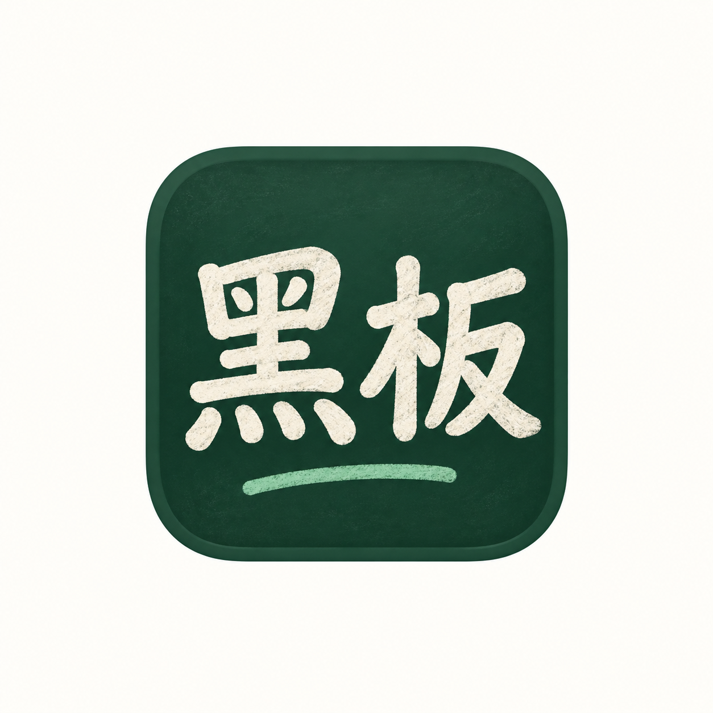

# 黑板：繁體中文字標提案與介面圖示

2026-10-08。使用者已選定 **05 手寫筆記**，作為黑板正式品牌。五張原始提案使用內建 image_gen 分別生成，完整提示詞保存在 [prompts.json](prompts.json)，原始 PNG 全部保留。

## 已採用的品牌

- 原始選定字標：[05-note-handwriting.png](05-note-handwriting.png)。使用 image_gen 去除底色，保留繁體手寫字、展開頁面及黃色頁籤；編輯提示詞保存在 [approved-logo-edit.json](approved-logo-edit.json)。
- 原生透明字標位於 `macos/Sources/HeiBanMac/Resources/HeiBanLogo.png`，首頁與「關於黑板」共用 `HeiBanLogo`。
- App 圖示採同一字標搭配象牙白圓角底，透過 `macos/scripts/package_brand_icon.swift` 依比例產生各尺寸。打包腳本產生 ICNS 並複製 SwiftPM 資源 bundle；啟動時同步設定 Dock 圖示。
- Web 首頁使用同一透明字標，工具列、favicon 及 Apple Touch Icon 使用同款方形 App 圖示。
- 原生版本 **1.0.1（20261008.2）**，可在「帳號與設定 → 關於黑板」確認。
- 首頁改為作品優先：移除大型標語及常駐建立表單，保留品牌、搜尋、作品與「新增」。名稱、三種格式、背景與尺寸集中於新增視窗。

| 編號 | 提案 | 特性 |
| --- | --- | --- |
| 01 | [粉筆圓體](01-chalk-rounded.png) | 深綠黑板、粉筆觸感，溫暖且能直接聯想到書寫。 |
| 02 | [現代印章](02-modern-seal.png) | 朱紅底、直排字標，中文辨識度強。 |
| 03 | [幾何墨字](03-geometric-ink.png) | 幾何粗字與深綠框，適合工具型產品。 |
| 04 | [書房宋體](04-literary-serif.png) | 宋體筆形與細金色角線，較安靜、文具感。 |
| 05 | [手寫筆記](05-note-handwriting.png) | 手寫字結合展開頁面與黃色頁籤，偏筆記與創作。 |

## 已套用到 macOS 的介面圖示

- **圖釘**：原創路徑繪製的短柱、弧形帽與尖針，斜向 35°，使用青藍漸層、深綠描邊及銀色針尖。按鈕、圖釘面板標題、圖釘清單、畫布標記與圖層中的圖釘物件共用 `HeiBanPinIcon`。形狀、傾斜角度與配色一致；依各處用途採 16／20／32 pt，畫布使用材質容器增加背景對比。參考圖僅用於「斜向圖釘」方向，沒有導入其檔案、像素或路徑。
- **筆記本**：左側裝訂與內頁橫線。
- **無邊界筆記**：無限符號與未封閉的邊界角線。
- **有邊界黑板**：閉合板面與底座。
- 三種格式使用一致的 24 pt 座標與 1.65 pt 圓角描邊。首頁縮圖左上角同時顯示圖示與名稱，深淺背景均使用實色標籤；圖示不阻擋卡片點擊。
- 使用文件本身的 `canvasMode`，舊文件缺少該值時再依 preset／尺寸推斷，未更改作品格式或內容。

原生可編輯來源：[HeiBanIcons.swift](../../../macos/Sources/HeiBanMac/Views/HeiBanIcons.swift)。這些介面圖示使用原生向量路徑，無須載入點陣素材；可直接縮放並維持清晰。

## 建置與查看記錄

- Release 建置成功；原有 SDK 搜尋路徑等警告仍存在。
- 使用獨立暫存 App 與作品庫，查看圖釘按鈕、標題、列表、畫布四處圖示一致。
- 首頁分別建立筆記本、無邊界與有邊界作品，三種標籤均已實際顯示；正式作品庫未新增這些預覽資料。
- 本次再次 Release 建置成功。隔離預覽實際顯示首頁 Logo、新增視窗及關於頁 Logo／新版版本號；建立筆記本及無邊界作品，看到新配色圖釘按鈕與畫布標記。正式作品庫未新增預覽資料。
- 未新增或執行自動測試。介面圖示及首頁佈局修改套用 macOS；Web 本輪同步品牌素材與首頁字標，尚未接入同一套圖釘／格式向量圖示。
- Web `pnpm build` 成功，仍有既有大型 chunk 警告；未進行本輪 Web 介面實機查看。
- 隔離預覽退出後已清除暫存 App／資料，並開啟正式新版首頁，確認選定 Logo、單一新增入口及既有作品縮圖顯示；未編輯正式作品。

## 01 粉筆圓體

## 02 現代印章

## 03 幾何墨字

## 04 書房宋體

## 05 手寫筆記

