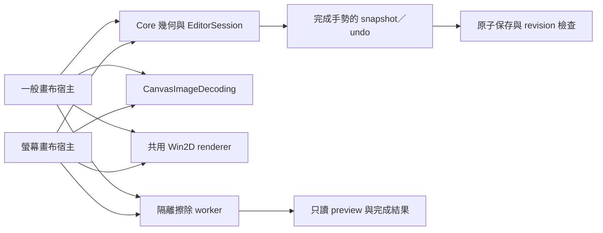

# Windows 1.1.6 開發架構與驗證流程檢討

## 開工

2026-11-20 使用者要求參考 Lauren Tan 的近期程式開發觀點，全面檢討並改善開發架構、流程與邏輯。依既有工作平台，執行 Windows 與 Windows 驗證流程的檢討。沿用 1.1.6。開工 git status 的三份已修改文件及三份未追蹤文件已記錄於本批暫存，保留現有內容。

先核對官方演講頁，再從實際程式、專案參考、CI 與原生驗證入口蒐集證據。實作前本文件即存在，後續追加發現、失敗方案與實際驗證。

## 參考來源與本專案的採用方式

本批以 Lauren Tan 在 2026-11-11 的演講為參考。重點是把反覆修正轉為 API、型別、靜態檢查及可重跑的行為驗證，減少規則僅存在於文字指示的情況。[官方演講與逐字稿](https://ai.engineer/code/2026/talks/lauren-tan)。

pstack 原始 README 將品質與可驗證性置於產碼量之前。HeiBan 採用問題重現、來源核對、行為驗證及證據交接的工作方式。此處對 Windows 的改善及取捨來自下列程式審查。[作者原始 README](https://github.com/cursor/plugins/blob/main/pstack/README.md)。

## 全面檢討

| 面向 | 可核對的現況與判斷 | 本批結果／後續驗收 |
| --- | --- | --- |
| 平台依賴 | Core 為 net10.0，WinUI／Win2D 在 Windows 宿主，macOS／Web 各自存放 | 新增 Core→UI 依賴檢查；本批實作為 Windows |
| 一般／螢幕畫布共用 | EditorSession、幾何、renderer、工具政策及 UI 工廠已共用；螢幕 HWND 和一般 XAML 控制項有不同輸入與座標邊界 | 收斂圖片編碼與方向讀取；繼續由宿主持有 UIElement 和 DIP／實體像素換算 |
| 宿主責任 | 靜態行數統計，MainWindow partial 約 6,654 行、ScreenAnnotationWindow partial 約 3,626 行，含原生診斷；Chrome 單檔 1,749 行 | 重複診斷入口集中。下一次修改工具列時，以工具設定／手勢／檔案交換分責任抽取，逐入口保留行為證據 |
| 畫筆熱路徑 | PointerMoved 早期分流、批次採樣、wet ink 預覽；永久點與一筆 Undo 在完成手勢時產生 | 針對現有採樣函式加入 I/O／序列化／交易／重建工具列的語法檢查 |
| 擦除 | worker 持有隔離 session、UI 使用 published preview、完成後合併交易 | 最佳化對照進入共用驗證。真實 4K、長筆跡及筆裝置延遲維持實機驗收 |
| 暫態狀態與非同步 | epoch／generation／頁面序號已用於圖片、擦除及存檔；宿主仍有多個手勢旗標 | 集中診斷模式並拒絕多模式。手勢有限狀態抽取列為後續結構工作，須涵蓋取消、失焦與切頁，未宣稱已形式驗證 |
| 圖片與 GPU | 影像預覽有裝置單邊及每張 1,600 萬像素上限，當頁快取；螢幕匯入仍有獨立 MIME／方向邏輯 | 共用讀取。預覽方向統一、解碼失敗留下不含內容的既有診斷檔。仍須日後以多張大圖實測總 GPU 預算 |
| 圖片文件體積 | 圖片可在 imageUrl 和 originalImageUrl 各存一份相同 Base64，雖然記憶體 snapshot 共用字串，JSON 保存仍可能重複寫出 | 本批沿用既有文件契約。以內容雜湊共用資產是後續縮檔方向，需先定義 Mac／Windows 相容讀寫及匯出策略 |
| 保存與相容性 | DocumentSnapshot 共用不可變圖片字串，逐物件複製可變資料；寫入有 gate、檔案鎖、revision 衝突與原子替換；unknown JSON 欄位保留 | 核心及最佳化保存／復原對照加入固定入口，文件 schema 維持現有契約 |
| 渲染成本 | 共用 renderer 有 committed scene／wet ink／髒區；螢幕 overlay 仍須 CPU 讀回與 HWND 呈現 | 本批未改寫圖形後端。後續採樣先拆解 PresentBitmap 讀回量、幀時與 UI 延遲，再決定是否導入 DirectComposition |
| 驗證可信度 | 核心斷言多，原生驗證與私人附件路徑分散。原生檢查以前 catch 後可正常 exit | 新 runner 留來源雜湊、日誌、輸出及 scope；原生失敗設非零 exit code；加入可重建合成長圖與 EXIF 檢查 |
| CI 與資產 | workflow 原本無 push；語言與指南產生工具會寫檔，缺少檢查模式 | push main／PR／手動共用同一驗證入口；--check 可攔過期產物。PR／手動的兩架構封裝等待 verify 成功，日常 push 跑快速檢查 |
| 體積與整理 | runtime 含自包含 .NET／Windows App SDK，原始碼行數不直接等於安裝大小；舊 updater 已排除產品編譯 | 新架構檢查是獨立開發工具，未加入 App 參考。未刪使用者資料與歷史包，體積改善須使用同類型套件比較 |
| 維護文件 | 狀態與日誌保有歷史，但開發者缺少單一可執行入口及使用者功能到程式的對照 | 建立 DEVELOPMENT_WORKFLOW，狀態及架構文件連回本批實際證據 |

## 實際責任與資料流

高頻輸入仍由各宿主管理，變換後進入暫態工具狀態與 renderer。文件保存及 undo 發生在明確邊界。工具列控制項各有一個視窗 parent，共用程式工廠與政策。

## 進行中發現

官方講題確認為 All Code Is Slop (Except Mine)。本地 CI 只有 workflow_dispatch 與 pull_request，平常直接 push main 不觸發。既有 Core 有幾何及資料測試，OptimizationChecks 有候選索引／復原／儲存對照，原生 WinUI 測試入口則分散且須逐次手寫啟動流程。先補共用驗證指令與有限、具體的架構檢查，再保留原生互動驗證及人工驗收的差異。

螢幕圖片匯入以副檔名判 MIME、使用未套方向的 PixelWidth／PixelHeight，與一般畫布的 EXIF 方向尺寸不同。移入 CanvasImageDecoding.ReadAsync 共用編碼辨識與尺寸。預覽全部使用既有方向解碼規則。診斷選項清單集中，拒絕空輸出及多模式；在初始化作品庫前檢查新資料路徑，正式執行檔也會明確拒絕驗證專用入口。原生診斷失敗以失敗 exit code 回報，降低只看程序結束而誤判的風險。

第一輪共用驗證在指南 manifest 檢查失敗。確認現存 manifest 有 CRLF，先前 write_text 在 Windows 會轉換換行，而新增 check 使用 bytes 與 LF 比較。只對既有兩個文字輸出位置正規化 CRLF 後比較，HTML／練習文件等有雜湊契約的輸出仍逐 byte 核對。保留 verify-r1 的失敗報告，未將此輪記為通過。

第二輪原生檢查有成功結果 JSON，但程序退出為 0xC0000005；另一個新隔離目錄重現相同退出碼。Windows Application Error 指向 Microsoft.UI.Xaml.dll。檢查原生測試直接 Application.Current.Exit，會繞過主視窗的正常保存、關閉與附屬視窗 Dispose。改為走既有 Close 邊界後重驗，此時原因仍屬待驗證假說。兩次故障目錄保留，未以成功 JSON 掩蓋非零退出。

第三輪顯示只改為正常 Close 仍會在 Microsoft.UI.Xaml.dll 以相同碼故障。再查測試最後一段是在成功 JSON 寫出後才 BuildChrome 並開啟 More popup，緊接關閉程序，沒有等候 popup 生命週期。改為等候 Opened／Closed 事件，並把成功證據寫在最後，驗證是否為根因。此嘗試和前輪假說分別保留。

第四輪完整共用驗證通過，來源在驗證期間一致。WinUI 編譯 0 警告／0 錯誤，native-editor 及 native-images 均以 0 退出，成功 JSON 存在且無 UI 錯誤。More popup 等待關閉後再進入正常 Close 可消除本機重現的測試退出故障。圖片檢查另包含 EXIF 90°，來源 120 × 60 正確成為 60 × 120。結果支持本機故障與未等待 popup 關閉的關聯，尚未證明所有 WinUI 關閉故障的原因。

之後僅調整 CI 證據上傳範圍，保留 JSON／日誌，開發中間二進位不列入 evidence artifact，該 artifact 保留 14 天。進行最終來源驗證時再次捕捉此工作樹，既有失敗輪次持續保留。

## 最終本機證據

- 執行 ./windows/scripts/Verify-Development.ps1 -OutputDirectory windows/.build/architecture-review-20261120/verify-final -IncludeNative。全部 8 步通過，來源 507 個程式與資源檔在驗證期間一致。
- Roslyn 架構檢查 194 份 C#，0 違規，政策自身 27 項檢查通過。核心 6,903 項、最佳化 68 項通過。這些數字分別代表資料／幾何及指定政策。
- x64 WinUI Release 編譯 0 警告、0 錯誤。原生一般／螢幕編輯、More popup 關閉及圖片檢查的兩份程序均正常退出。合成長圖 384 × 18000，適應後 6 × 300，裁切／翻轉／Undo／Redo／重開檢查通過。EXIF 方向來源 120 × 60 正確呈現 60 × 120。
- 十語介面及指南資源檢查通過，--check 未寫入來源。該次 .NET 10.0.401，Python 3.11.9。
- 實機滑鼠／數位筆延遲、硬體 IME、ARM64 執行與 Store 認證未執行。完整摘要見 [驗證資料](ARCHITECTURE_VERIFICATION_2026-11-20.json)。日常命令與功能對照見 [開發流程](DEVELOPMENT_WORKFLOW.zh-TW.md)。

## 將已重現問題落到產品 API

進一步審查發現主視窗正常關閉原本也只呼叫 Hide 後等 32ms，無法證明 native popup 已完成移除。本批新增 DismissActiveFlyoutAsync，等待 Closed 事件後才讓關閉／離開流程進入保存與資源釋放；ShowAt 失敗時解除目前 popup 參考。原生檢查調整為保留 More 開啟，直接走正式 Close，驗證產品流程自行等候，不由測試預先收起選單。

產品關閉流程驗證通過。保持 More popup 開啟並直接 Close 的 native-editor 退出為 0，圖片檢查也正常退出。初版 GitHub run 44689277249 的 verify、x64 與 ARM64 封裝全部成功。此完整試跑證明既有兩架構封裝可接新 verify 前置工作。為減少每次日常 push 的二進位產物與等待，後續 push 執行 verify，PR／手動保留原本兩架構封裝行為。

## 產品流程的交付驗證

最終以 verify-delivery 新目錄執行完整 8 步，全部通過。Core 6,903、Optimization 68、Roslyn 194 份來源與 27 項政策案例，正常關閉時保留 More popup 開啟，驗證主視窗自行等待 Closed 後正常退出。來源 507 份程式與資源在本輪維持一致，來源與證據摘要已更新。先前 verify-final 是更早的診斷處理版本，交付以 verify-delivery 及其後封裝來源為準。

首輪 GitHub verify、x64 封裝與 ARM64 封裝全部通過。[完整 CI 結果](https://github.com/VirginBear/HeiBan/actions/runs/44689277249)。後續工作樹的 CI 將以 push 快速核對流程再確認。
